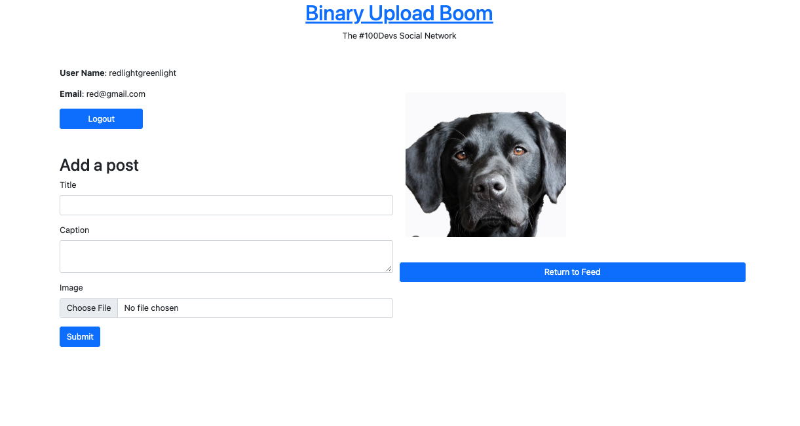

# ☀️ Bank Rec Assist
Attention Bookkeepers! Use this app for help with completing monthly reconciliations! 

# Link
[Check out the Site!](https://bank-rec-assist.onrender.com/)

# 📷 Images

# 📋 How to use
Use login details:   
Username: sample@sample.com     
Password: SampleSample

# ✨ Features
Fully responsive design for desktop and mobile.         

# 🔨 Built With
HTML5 – structure,    
CSS3 – responsive design and background,    
JavaScript - frontend and backend.   
Node - backend.   

# 🧠 What I Learned
How to work with Node.    
How to work with APIs.   
How to use fetch().   
How to work with JSON data.  
How to manipulate the DOM.  
How to handle errors.  
